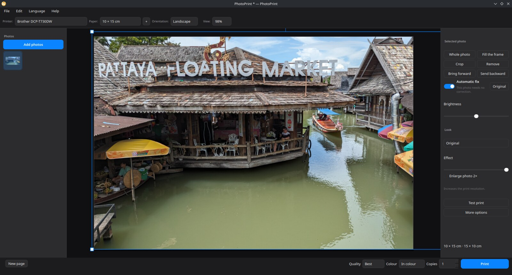

# PhotoPrint

A lightweight, local desktop application for arranging family photos on paper,
cropping them, and printing them. It is built for people who do not want to
learn image processing or printer technology: add photos, choose the paper,
place them on the sheet, and print.



Built with C++20 and Qt 6 Widgets. Colour conversion uses LittleCMS2, printing
uses the existing CUPS queues, and photo filters/upscaling use ImageMagick's
MagickWand.

## Features

- Import JPEG and PNG at original resolution, with EXIF orientation and embedded
  ICC profiles (Display P3 included).
- A white paper canvas with direct move, resize, rotate, fit/fill and a separate
  crop mode; keyboard nudging and undo/redo.
- Multiple photos and pages, layer order, page copy/delete/reorder.
- Photo-library sidebar, canvas and context-sensitive inspector.
- Automatic, conservative tone correction plus a manual brightness slider.
- 120 effects in 12 categories with a preview browser, search and a strength
  slider. Looks are graded recipes, not single filter primitives; the browser
  previews on the selected photo (or a bundled sample) and the print matches the
  preview. Legacy projects keep their original looks.
- 55 collage layouts for 2 to 10 photos. A layout creates numbered sections you
  can drop photos into, pan and zoom inside, and clip to the section. A section
  is the photograph itself: the white paper between sections is the adjustable
  gap, not a coloured frame. The outer margin, the gap and an optional corner
  radius are adjustable per page. Empty sections show a drop target on screen
  and print as plain paper.
- Batch portrait sheets: 35 × 45 mm passport copies and custom sizes, fill the
  sheet or choose a count, overflow on new pages, optional cut guides, exact
  print size without borderless enlargement. Auto align into equal cells or
  distribute existing photos without resizing.
- The canvas keeps a cached composition, so pan, zoom and dragging stay
  responsive; previews are rendered in the background.
- 2x Lanczos enlargement for print (with a light sharpen; it is not an AI model).
- Paper sizes in centimetres: A4, A5, A6, 9 × 13, 10 × 15 and 13 × 18 cm, plus
  saved custom paper profiles and glossy/matte/plain types.
- Print quality (highest/normal), colour or grayscale, copies and page count.
  The raster follows the resolution the queue advertises: up to 1200 ppi in the
  highest mode, 300 ppi in normal, and lower if the printer cannot use more.
- The chosen printer, paper, orientation and print settings are remembered.
- Versioned `.ppj` projects, portable copies that carry the originals, atomic
  saves and two-slot crash recovery.
- One print action = one snapshot, one PDF, one CUPS submission; no automatic
  reprint after an uncertain response.
- Follows the system light/dark colour scheme.

## Requirements

- Linux desktop (Fedora 44 is the tested environment).
- CMake 3.21 or newer and a C++20 compiler.
- Qt 6.5 or newer: Core, Gui, Widgets, Concurrent, Test.
- LittleCMS2, CUPS, zlib and ImageMagick 7 development files
  (`MagickWand`).
- Poppler command-line tools (`pdfinfo`, `pdftoppm`, `pdfimages`) for the
  PDF evidence tests.

Fedora development packages used here:

```bash
sudo dnf install cmake ninja-build gcc-c++ qt6-qtbase-devel qt6-linguist \
  lcms2-devel cups-devel zlib-devel ImageMagick-devel poppler-utils
```

Package names differ on other distributions; the same libraries are required.

## Build and run

```bash
cmake --preset dev
cmake --build --preset dev
./build/dev/photoprint
```

Release build:

```bash
cmake --preset release
cmake --build --preset release
./build/release/photoprint
```

## Tests

```bash
QT_QPA_PLATFORM=offscreen ctest --test-dir build/dev --output-on-failure
```

The suite covers colour conversion, geometry, PDF output, alpha composition,
project recovery, filters, tone correction, print submission and the daily UI
flow. A few acceptance tests read the local sample photo at
`/home/lavx/Downloads/IMG20260830150231.jpg`; on another machine, adjust that
path or skip those tests. Tests never print.

## Portable AppImage

```bash
./packaging/build-appimage.sh
# build/release/PhotoPrint-<version>-x86_64.AppImage
```

The script downloads the standard AppImage tooling once into
`build/appimage-tools`, bundles Qt, LittleCMS2, CUPS and ImageMagick, and adds
the XCB, Wayland and minimal platform plugins. The resulting AppImage is about
47 MB and runs on Wayland and X11 desktops without installing PhotoPrint. If
FUSE is unavailable, run it with `--appimage-extract-and-run`.

On the first run the AppImage registers a per-user desktop entry and icons
under `~/.local/share`, which is what Wayland compositors use to show the app
icon and name in the title bar and task bar. It is skipped when PhotoPrint is
already installed system-wide.

## Flatpak

The manifest is `packaging/hu.lavx.PhotoPrint.yml` and targets the KDE runtime,
which already provides Qt 6, LittleCMS2 and CUPS. ImageMagick is built as a
module inside the sandbox.

```bash
flatpak install flathub org.kde.Platform//6.11 org.kde.Sdk//6.11
flatpak-builder --force-clean --user --repo=build/flatpak-repo \
  build/flatpak packaging/hu.lavx.PhotoPrint.yml
flatpak build-bundle build/flatpak-repo build/PhotoPrint-<version>-x86_64.flatpak \
  hu.lavx.PhotoPrint
flatpak install --user build/PhotoPrint-<version>-x86_64.flatpak
```

The sandbox gets Wayland and X11, GPU access, the CUPS socket, and read access
to Pictures, Downloads and Documents. Printing uses the host queues through the
CUPS socket; the application bundles no driver. A photo outside those folders
can be opened through the file chooser portal.

## Fedora package

```bash
rpmbuild -bb packaging/photoprint.spec \
  --define "_topdir $PWD/build/rpm" \
  --define "photoprint_source $PWD"
```

The spec builds from the local source tree without network access. It is
Fedora-specific; other distributions can build with CMake and package the
result themselves.

## Platform notes

- Fedora 44 with KDE Plasma/Wayland is the environment this was developed and
  measured on, but the application does **not** link to KDE libraries. It uses
  Qt Widgets only, so GNOME, XFCE and other Linux desktops work the same way.
- It runs on Wayland and X11. The window chrome follows the system theme; the
  application itself provides both light and dark palettes.
- macOS and Windows are not tested. The CUPS printer discovery and the RPM
  packaging are Linux-specific.

## Languages

The interface is available in ten languages beside Hungarian: English,
Simplified Chinese, Hindi, Spanish, French, Portuguese, Russian, Japanese,
German and Italian. Hungarian is the source language, so it is always complete,
and it is used when the system language is not supported.

Pick a language in the `Language` menu; each entry is shown in its own script
and the whole window switches immediately, without a restart. The choice is
remembered for the next start, which then uses the saved language, then the
supported system language, then Hungarian. The setting is stored in
QSettings under `language`.

Translations are Qt TS/QM files: the source is
`resources/i18n/photoprint_<locale>.ts`, the build compiles them with
`lrelease-qt6` and embeds the result as `:/i18n`, so the installed package needs
no extra files. Strings live in the `PhotoPrint` translation context; add new
ones with `QCoreApplication::translate` and refresh the TS files with
`lupdate-qt6`. Qt's own standard button labels come from the system `qtbase`
catalogue when it is installed.

Licence text and product names (paper size names, PPD option names) are not
translated. The ten catalogues are hand-authored and waiting for a native
speaker review, especially Hindi and Russian.

## Usage

The photo library is on the left, the paper is in the centre, and the inspector
for the selected photo is on the right. Printer, paper and orientation are in
the top bar. The bottom bar holds page handling, print quality, colour mode,
copies and the Print button. PDF export is available from the File menu.

A project file (`.ppj`) stores the pages, paper, geometry, crop, tone, filters
and source identities. Saving is atomic; the recovery snapshots are separate
from the print path.

## Limitations

Printing was verified on a Brother DCP-T730DW with 10 × 15 cm photo paper.
Matte paper has no distinct driver media type and is sent as inkjet paper.
The Wayland performance measurement and the 20-source memory target have not
been measured yet. Multi-select and cross-page dragging are not implemented.

## License

MIT. See `LICENSE`.
